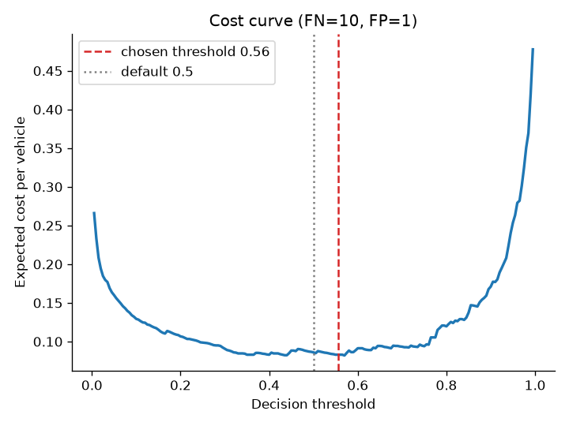
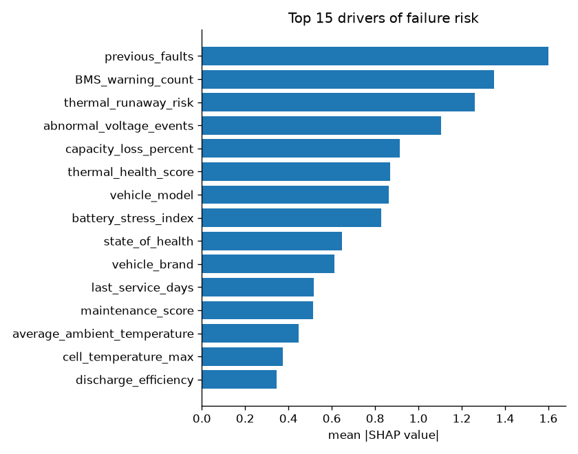
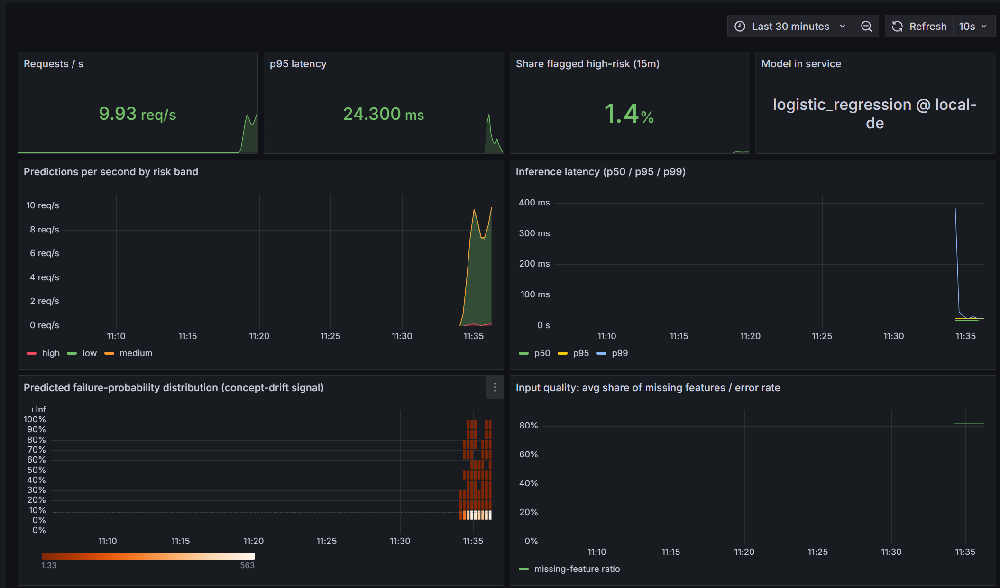
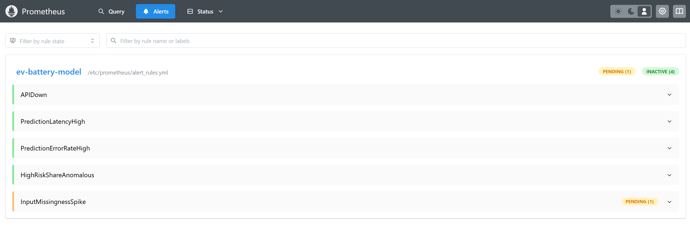
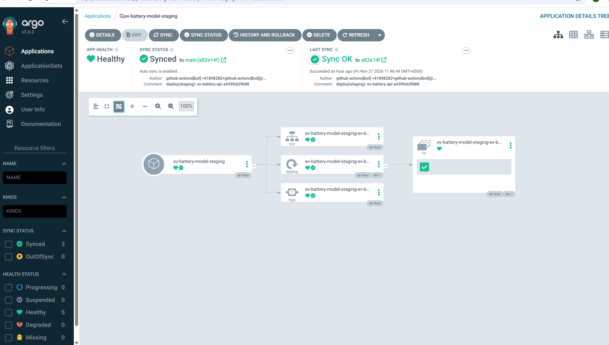
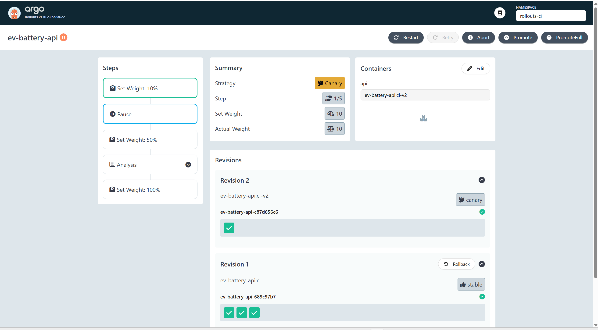
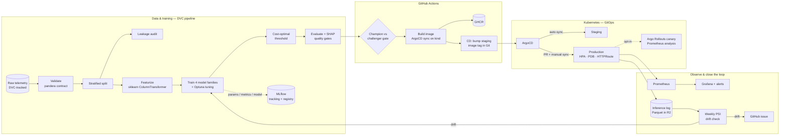

<div align="center">

# 🔋 EV Battery Failure Prediction — End-to-End MLOps

**Catch failing EV battery packs before they strand a driver: a production-style ML system, from raw telemetry to a monitored, self-retraining API on Kubernetes.**

[](https://github.com/akinpelumiajayi/ev-battery-failure-prediction/actions/workflows/ci.yml)
[](https://github.com/akinpelumiajayi/ev-battery-failure-prediction/actions/workflows/drift-check.yml)


[](LICENSE)

**[▶ Live demo](https://ev-battery-demo.onrender.com/)** · **[API docs (Swagger)](https://ev-battery-api-8zjw.onrender.com/docs)**<br>
<sub>Free-tier hosting: the first visit after ~15 min idle can take 1–3 minutes while the services wake up.</sub>

`DVC` · `MLflow` · `Optuna` · `SHAP` · `FastAPI` · `Docker` · `Kubernetes` · `Helm` · `ArgoCD` · `Argo Rollouts` · `Gateway API` · `GitHub Actions` · `Prometheus` · `Grafana` · `Cloudflare R2` · `Streamlit`

</div>

---

## The problem

A battery pack is the most expensive component of an electric vehicle. When one fails in service the
result is a roadside breakdown, a warranty pack replacement and sometimes a thermal-safety incident.
A fleet operator can't inspect every vehicle every week, so the real question is **which vehicles to
inspect now**.

This project answers that question from routine telemetry (BMS readings, charging behaviour, driving
patterns and environment). Because it is built as a *system* rather than a notebook, the model is also
versioned, tested, gated, deployed, observed and retrained automatically.

## Results

Held-out test set: 3,000 vehicles, 208 real failures (6.9 %). None of these vehicles were seen during
training, model selection or threshold tuning.

| | v1 (RandomForest, threshold 0.5) | **v2 (this version)** |
|---|---:|---:|
| ROC-AUC | 0.956 | **0.985** |
| PR-AUC (average precision) | 0.610 | **0.785** |
| Recall: failures caught | 62.0 % (129 / 208) | **95.2 % (198 / 208)** |
| Precision: flagged vehicles that really fail | 57.1 % | 57.1 % |
| Missed failures | 79 | **10** |

**Business view.** A missed failure is costed at 10× an unnecessary inspection, so the model flags
11.6 % of the fleet for inspection:

| Policy | Expected cost / vehicle | vs. doing nothing |
|---|---:|---:|
| Inspect nobody | 0.693 | — |
| Inspect everybody | 0.931 | +34 % |
| **Model, cost-optimal threshold** | **0.083** | **−88 %** |

<table>
<tr>
<td></td>
<td></td>
</tr>
<tr>
<td></td>
<td></td>
</tr>
</table>

> All figures and metrics are produced by `dvc repro` and regenerated by CI on every run. Numbers in
> this README come from [`models/test_metrics.json`](models/test_metrics.json).

## See it running

Everything below is live or recorded by CI, so you can check it yourself.

### Try it now
| What | Link | What you'll see |
|---|---|---|
| **Demo UI** | [ev-battery-demo.onrender.com](https://ev-battery-demo.onrender.com/) | Pick a preset vehicle, get a failure risk and the top factors behind it |
| **API docs** | [`/docs`](https://ev-battery-api-8zjw.onrender.com/docs) | Swagger UI; try `/predict`, `/predict/batch` and `/explain` in the browser |
| **Model in production** | [`/model`](https://ev-battery-api-8zjw.onrender.com/model) | Model name, git SHA, decision threshold (0.555) and test metrics of the version being served |
| **Health** | [`/health`](https://ev-battery-api-8zjw.onrender.com/health) | `{"status":"ok","model_loaded":true,...}` |
| **Prometheus metrics** | [`/metrics`](https://ev-battery-api-8zjw.onrender.com/metrics) | Raw latency, prediction-count, risk-band and error counters that Grafana and the canary analysis use |
| **Container image** | [GHCR package](https://github.com/akinpelumiajayi/ev-battery-failure-prediction/pkgs/container/ev-battery-failure-prediction) | `docker pull ghcr.io/akinpelumiajayi/ev-battery-failure-prediction:latest` |

<sub>Free-tier hosting: the first visit after ~15 min idle can take 1–3 minutes while the services wake up.</sub>

### The monitoring loop, end to end, on live traffic
The live API logs every prediction as Parquet to object storage (Cloudflare R2). The drift check reads
the last 7 days of those logs back and compares them with the training data. On a run against real
traffic it caught the drift, updated the issue and retrained the model through the full quality and
champion/challenger gates, all without a person involved:

1. **Traffic:** 853 requests to the live API from `scripts/load_test.py` (0 errors, p95 426 ms), plus demo clicks
2. [**Drift check run**](https://github.com/akinpelumiajayi/ev-battery-failure-prediction/actions/runs/45913328491): read **933 logged predictions from 34 files** in R2; PSI flagged **23 of 67 features** (top: `terrain_type`, `fleet_or_private`, `battery_manufacturer`)
3. [**Issue #2**](https://github.com/akinpelumiajayi/ev-battery-failure-prediction/issues/2): opened or updated automatically with the drifted features and their PSI scores
4. [**Retraining run**](https://github.com/akinpelumiajayi/ev-battery-failure-prediction/actions/runs/45913422733): CI dispatched by the drift check, `dvc repro`, gates passed

The drift is genuine but expected: the load test draws its inputs at random, so they don't follow the
training distribution, and the check is right to flag them. The same loop was first shown on a
[simulated heatwave batch](https://github.com/akinpelumiajayi/ev-battery-failure-prediction/actions/runs/45084856760)
(10 features flagged, [retrained](https://github.com/akinpelumiajayi/ev-battery-failure-prediction/actions/runs/45084950092)).

The check runs [every Monday](.github/workflows/drift-check.yml) on the logged production traffic. With
no log storage configured it falls back to the held-out test batch, where it should find no drift; with
fewer than 500 logged rows it skips instead of judging a tiny sample.

### Proved on every CI run
Each [CI run](https://github.com/akinpelumiajayi/ev-battery-failure-prediction/actions/workflows/ci.yml)
writes a summary with the evidence. Open any green run and scroll to the summary:

- **Model report:** metrics, gate results and champion/challenger comparison (also posted on PRs)
- **GitOps, staging:** ArgoCD on kind auto-syncs this commit from Git, reaches *Synced / Healthy*, and restores a Service deleted by hand
- **GitOps, prod:** the real prod Application stays *OutOfSync* with nothing deployed until a manual sync, then runs 3 replicas with HPA and PDB; Prometheus scrapes every pod through the ServiceMonitor, and the HTTPRoute serves the prod hostname through the shared Gateway
- **Canary:** pauses at a 90/10 HTTPRoute split; the Prometheus analysis passes a good model (high-risk share ≈ 10 %), **aborts a model that is fast but wrong** (every pack "high") and a broken image, with traffic snapping back to stable each time

### Screenshots
Captured on a local kind cluster and the Docker Compose stack; see "Run it yourself" below to reproduce them.

<table>
<tr>
<td width="50%"><br><sub>Grafana under <code>make load-test</code>: ~10 req/s, p95 24 ms, risk-band mix and the predicted-probability heatmap</sub></td>
<td width="50%"><br><sub>Prometheus: the 5 alert rules; <code>InputMissingnessSpike</code> goes pending because the load test sends partial payloads</sub></td>
</tr>
<tr>
<td width="50%"><br><sub>ArgoCD: staging auto-synced from <code>main</code>, Synced / Healthy (Service, Deployment, HPA)</sub></td>
<td width="50%"><br><sub>Argo Rollouts: canary paused at 10 %, stable revision 1 still serving 90 %</sub></td>
</tr>
</table>

### Run it yourself
| To see | Run | Then open |
|---|---|---|
| Grafana dashboard + alerts | `make docker-up`, then `make load-test` | http://localhost:3000, http://localhost:9090/alerts |
| ArgoCD syncing from Git | `make kind-up kind-addons` (metrics-server keeps the HPA healthy), [install ArgoCD](https://argo-cd.readthedocs.io/en/stable/getting_started/), `make argocd-bootstrap` | `kubectl port-forward svc/argocd-server -n argocd 8080:443` → https://localhost:8080 |
| A canary paused at 10 % | `make kind-up docker-build canary-demo` | http://localhost:3100 (promote or abort from the dashboard) |

## Architecture



## What this project demonstrates

| Capability | How | Where |
|---|---|---|
| **Reproducible pipeline** | 7-stage DVC DAG. Every parameter lives in `params.yaml`; `dvc repro` re-runs only what changed | [`dvc.yaml`](dvc.yaml), [`params.yaml`](params.yaml) |
| **Data contract** | pandera schema and business rules (ranges, uniqueness, class balance) fail the pipeline early | [`src/data/validate.py`](src/data/validate.py) |
| **Data versioning** | DVC pointer + md5-verified public mirror, so CI and fresh clones train on byte-identical data | [`src/data/fetch_data.py`](src/data/fetch_data.py) |
| **Leakage audit** | Single-feature AUC scan plus an ablation that removes every derived score | [`src/evaluation/leakage_audit.py`](src/evaluation/leakage_audit.py) |
| **Principled model selection** | 4 model families + Optuna, compared by 5-fold CV PR-AUC, all logged as nested MLflow runs | [`src/training/train.py`](src/training/train.py) |
| **Business-aware decisions** | Threshold chosen to minimise expected cost (FN = 10 × FP), not left at 0.5 | [`src/training/metrics.py`](src/training/metrics.py) |
| **Explainability** | SHAP global importance; per-prediction `/explain` endpoint returns the top risk factors | [`src/serving/app.py`](src/serving/app.py) |
| **Quality gates** | Absolute floors (ROC-AUC ≥ 0.90, PR-AUC ≥ 0.55), and a challenger may not regress PR-AUC by more than 0.02 vs. `main` | [`evaluate.py`](src/evaluation/evaluate.py), [`promotion_gate.py`](src/evaluation/promotion_gate.py) |
| **Model registry** | Each run registers a version; passing the gates moves the `@champion` alias | MLflow |
| **Serving** | FastAPI with typed contracts, batch endpoint, model card endpoint, Prometheus metrics | [`src/serving/`](src/serving) |
| **Containers** | Multi-stage, non-root image with the model baked in (immutable code + model per tag) | [`docker/`](docker) |
| **Kubernetes** | Helm chart: HPA, PDB, zero-downtime rolling updates, read-only root FS, ServiceMonitor, Gateway API HTTPRoute | [`helm/`](helm/ev-battery-model) |
| **GitOps CD** | CI only edits Git; ArgoCD auto-syncs staging; prod goes via promotion PR + manual sync. Every CI run installs ArgoCD on kind and tests both Applications: staging auto-syncs and self-heals; prod waits for the manual sync, then comes up Healthy and scraped by Prometheus | [`argocd/`](argocd), [`.github/workflows/`](.github/workflows) |
| **Progressive delivery** | Argo Rollouts canary, 10 % → 50 % → 100 %, with exact traffic weights through the Kubernetes Gateway API (Envoy Gateway). Between steps a Prometheus analysis of the *canary pods only* checks p95 latency, error rate and the **share of high-risk predictions** (expected ≈ 11.5 %; a model that is fast but wrong aborts). Every CI run checks on kind, with kube-prometheus-stack and live traffic, that the route is split 90/10 at the pause, that the analysis passes a good model, and that it aborts both a model that is fast but wrong and a broken image. *Opt-in: prod still uses the chart's rolling update* | [`argocd/canary/`](argocd/canary), [`scripts/canary.sh`](scripts/canary.sh) |
| **Monitoring** | Latency, throughput, risk-band mix, probability distribution, input missingness, errors; 5 alert rules | [`monitoring/`](monitoring) |
| **Closed loop** | The API logs every prediction to object storage; a weekly PSI drift check (numeric + categorical) on that real traffic opens an issue and dispatches retraining | [`inference_log.py`](src/serving/inference_log.py), [`drift-check.yml`](.github/workflows/drift-check.yml) |
| **Engineering hygiene** | 62 hermetic tests, ruff, mypy, pre-commit, pinned lockfiles, `make help` | [`tests/`](tests), [`Makefile`](Makefile) |

## Quickstart

```bash
git clone https://github.com/akinpelumiajayi/ev-battery-failure-prediction.git
cd ev-battery-failure-prediction
python -m venv .venv && source .venv/bin/activate      # Python 3.12
make setup            # pinned dev dependencies + pre-commit hooks

make pipeline         # fetch data (md5-verified) → dvc repro  (~3 min on a laptop)
make test             # 62 tests
make serve            # API on http://localhost:8000/docs
make demo             # Streamlit UI on http://localhost:8501 (second terminal)
```

To run the whole stack in Docker (API, demo UI, MLflow, Prometheus and Grafana), run
`make docker-up`, then `docker compose --profile loadgen up loadgen` to send traffic.

| Service | URL |
|---|---|
| Demo UI | http://localhost:8501 |
| API (Swagger) | http://localhost:8000/docs |
| MLflow (experiments + registry) | http://localhost:5000 |
| Grafana (pre-provisioned dashboard) | http://localhost:3000 |
| Prometheus (alerts) | http://localhost:9090/alerts |

To run on Kubernetes locally, use `make kind-up kind-deploy`. This builds the image, loads it into kind and
installs the Helm chart with `--wait`.

To watch a canary release, run `make kind-up docker-build canary-demo`. It installs Argo Rollouts, Envoy
Gateway and Prometheus on kind, deploys v1, starts a canary of v2 and leaves it paused at 10 %, then opens the Argo Rollouts
dashboard on http://localhost:3100 (promote or abort it from there). `make canary-test` runs the same
scenario as CI, end to end.

Run `make help` to list every target.

## The ML, in more detail

The design starts from data: the [EDA notebook](notebooks/01_eda.ipynb) maps each finding (class
imbalance, missingness, derived scores, signs of synthetic data) to the pipeline decision it drove.

### Model selection: the simplest model won

Every candidate is scored with **stratified 5-fold CV PR-AUC** on the training fold. PR-AUC is the
honest metric for a 7 % positive class, and CV is far less noisy than a single validation split with
about 200 positives. Optuna tunes LightGBM on the same folds, so all candidates compete on equal terms.

| Model | CV PR-AUC | Val PR-AUC | Val ROC-AUC |
|---|---:|---:|---:|
| **Logistic regression** (balanced) | **0.784** | 0.855 | 0.988 |
| LightGBM + Optuna (25 trials) | 0.779 | 0.847 | 0.986 |
| LightGBM | 0.768 | 0.844 | 0.986 |
| XGBoost | 0.767 | 0.847 | 0.986 |
| Random forest (v1 baseline) | 0.620 | 0.681 | 0.959 |

Regularised logistic regression edges out tuned gradient boosting. The signal in this dataset is close to
linear in the standardised features, so the extra capacity of boosting buys nothing. The linear model
also gives exact, cheap explanations and has a tiny serving footprint. The pipeline still runs every
family on each retrain, so if the data changes and boosting pulls ahead, it is promoted automatically.

### Decision threshold from a cost model, not 0.5

`params.yaml` sets the cost of a missed failure at 10 and an unnecessary inspection at 1. The threshold
minimising expected cost on the **validation** fold (0.555) is stored with the model and used by the API.
Risk bands are defined relative to it: *high* means "would be flagged" and *medium* starts at half the
threshold. If the business changes its cost ratio, it edits one number and the pipeline re-derives the
threshold.

### Is a 0.98 AUC too good to be true? The leakage audit

Eight columns are derived scores of unknown provenance (`thermal_runaway_risk`, `aging_score`,
`predicted_remaining_life_cycles`, …). If any were computed *from* the outcome, offline metrics would be
fiction. The `leakage_audit` stage checks this ([`reports/leakage_audit.json`](reports/leakage_audit.json)):

* **No single feature is suspiciously predictive.** The best one alone reaches AUC 0.85; the flag threshold is 0.95.
* **Ablation:** retraining with all eight derived scores removed leaves ROC-AUC almost unchanged
  (0.986 → 0.982, PR-AUC 0.837 → 0.799). The model's skill comes from raw sensor and usage signals, not
  from opaque pre-computed scores.

### Explainability

The global drivers of risk (above) are prior faults, BMS warnings, thermal risk, abnormal voltage
events, capacity loss and state of health, all physically plausible. Per prediction, `POST /explain`
returns exact SHAP contributions in log-odds, aggregated back from one-hot columns to the raw input
fields, so a technician sees *why* a vehicle was flagged.

## Serving API

| Method | Path | Purpose |
|---|---|---|
| `GET` | `/health` | Liveness/readiness (`degraded` if the model failed to load) |
| `GET` | `/model` | Model name, version (git SHA), threshold, risk bands, test metrics |
| `POST` | `/predict` | One vehicle → probability, decision, risk band |
| `POST` | `/predict/batch` | Up to 1,000 vehicles per call |
| `POST` | `/explain` | Prediction + top-k SHAP risk factors |
| `GET` | `/metrics` | Prometheus exposition |

```bash
curl -s -X POST localhost:8000/explain -H 'Content-Type: application/json' \
  -d '{"state_of_health": 64, "internal_resistance": 0.82, "BMS_warning_count": 5, "previous_faults": 3}'
```

Every field is optional, because real fleets have gaps. Missing values are filled by the *same fitted
imputer* used in training, out-of-range inputs are rejected with `422`, and unseen categories are handled.

## CI/CD and GitOps

| Workflow | Trigger | What it does |
|---|---|---|
| [`ci.yml`](.github/workflows/ci.yml) | PR, push to `main`, manual / drift dispatch | Runs lint, types, tests and Helm lint. Fetches the data, runs the full `dvc repro` with quality gates and the champion/challenger gate, and posts a model report on the PR. Verifies that the drift alarm fires. Builds the image and smoke-tests it in Docker. Then installs ArgoCD on a kind cluster, lets it sync this commit's chart from Git (`argocd/application-staging.yaml`), smoke-tests the result, deletes a resource by hand to prove ArgoCD self-heals it, deploys the real prod Application and checks its manual gate, ServiceMonitor scraping and HTTPRoute, runs the Argo Rollouts canary with Prometheus analysis (good model promoted; wrong model and broken image aborted), and pushes the image to GHCR (main only). |
| [`cd.yml`](.github/workflows/cd.yml) | CI green on `main` | Rewrites `image.tag` in `values-staging.yaml` and commits; ArgoCD auto-syncs staging |
| [`promote-prod.yml`](.github/workflows/promote-prod.yml) | Manual | Verifies the image exists and opens a PR pinning prod to it; after review, prod is synced manually |
| [`drift-check.yml`](.github/workflows/drift-check.yml) | Weekly + manual (with scenarios) | Runs the PSI drift check. On drift it opens or updates a `data-drift` issue and dispatches CI to retrain |

**Why GitOps?** CI never holds cluster credentials. The cluster state is a pure function of Git, so
every production change has a reviewed commit, and a rollback is a `git revert`. Staging syncs
automatically for fast feedback. Production needs a reviewed PR *and* a manual sync.

## Monitoring and the drift loop

Ground truth (did the battery actually fail?) arrives weeks after a prediction, so the system watches
the earliest available proxies:

* **Service:** p50/p95/p99 latency, throughput, error rate (`APIDown`, `PredictionLatencyHigh`, `PredictionErrorRateHigh`)
* **Model output:** share of high-risk predictions and the full probability histogram (`HighRiskShareAnomalous`)
* **Input quality:** share of missing features per request (`InputMissingnessSpike`)
* **Data drift:** per-feature **PSI** against the training snapshot, numeric (decile bins with open-ended
  tails) and categorical (frequency, unseen categories included)

A batch counts as drifted when more than 10 % of features exceed PSI 0.2, **or** any single feature
exceeds PSI 1.0 (a broken upstream pipeline or a new market should never wait for a majority vote). Try it:

```bash
make drift-demo        # simulate a heatwave: hotter cells, more fast charging, degraded cooling
# DRIFT DETECTED: 10/67 features (15%) over PSI 0.20 — top: cell_temperature_max, ...
```

The same three scenarios (`heatwave`, `aging`, `new_market`), plus `production` (the logged live
traffic), can be run from the **Actions → Drift check** tab to watch the issue → retrain → gate → deploy
loop end to end. CI also asserts on every run that a
simulated drifted batch trips the alarm, so the monitor itself is tested.

### Monitoring real traffic: the inference log

Simulated batches prove the alarm works; the inference log points it at what the API is actually asked.

```
request ─▶ API ─▶ response (no extra latency)
             └─▶ in-memory buffer ─(every 500 rows or 60 s)─▶ Parquet in object storage
                    s3://<bucket>/<prefix>/date=2026-11-26/model=22f8aa80/133005-1f3a9c2e.parquet
weekly drift check ─▶ reads the last 7 days ─▶ PSI vs. the training snapshot ─▶ issue + retrain
```

* **What is logged:** timestamp, request id, endpoint, model version, the raw inputs as the model saw
  them, the probability, the risk band and the decision. The request schema accepts telemetry only
  (no vehicle or owner identifiers), so the log holds no personal data.
* **Serving comes first:** the request path only appends to a bounded buffer; a background thread
  writes. If storage is down the batch is dropped and counted (`inference_log_dropped_total`), and
  predictions are never slowed or failed. `INFERENCE_LOG_SAMPLE_RATE` thins high-volume traffic.
* **Anywhere S3 speaks:** `INFERENCE_LOG_URI=s3://bucket/prefix` with the usual `AWS_*` variables;
  set `AWS_ENDPOINT_URL` for Cloudflare R2, Backblaze B2 or MinIO. A local directory works too.
  Off unless the URI is set. In Kubernetes: `inferenceLog.*` in the Helm values.
* **No false alarms on thin data:** with fewer than 500 logged predictions in the window, the check
  is skipped and says so instead of computing PSI on a handful of rows.
* **Scheduled drift checks switch to real traffic** as soon as the `INFERENCE_LOG_URI` secret is set;
  until then they fall back to the held-out split. `scenario: production` runs it on demand.

Try it locally: `make docker-up` (the API logs to a volume), `make load-test`, wait ~30 s for the
flush, then `make drift-production`.

## Repository layout

```
├── src/
│   ├── common.py              # paths, params, logging
│   ├── data/                  # fetch_data (md5-verified) · validate (pandera) · preprocess (split)
│   ├── features/              # ColumnTransformer fit on train only → reused by the API
│   ├── training/              # model factory · metrics/threshold · train (CV + Optuna + MLflow)
│   ├── evaluation/            # evaluate (gates, SHAP, figures) · promotion_gate · leakage_audit
│   ├── monitoring/            # drift_check (PSI) · simulate_drift (scenarios) · inference_logs (reader)
│   └── serving/               # FastAPI app + pydantic schemas + inference_log (writer)
├── notebooks/01_eda.ipynb     # EDA — each finding mapped to a pipeline design decision
├── tests/                     # 62 hermetic tests (synthetic fixtures, no pipeline needed)
├── demo/                      # Streamlit UI (talks to the API over HTTP)
├── docker/                    # serve · train · demo images
├── helm/ev-battery-model/     # chart + staging/prod values (what ArgoCD deploys)
├── argocd/                    # Applications (staging auto, prod manual)
│   └── canary/                # opt-in canary: base (prod) + kind overlay (CI-tested)
├── monitoring/                # Prometheus config + alerts, Grafana provisioning + dashboard
├── reports/                   # figures, leakage audit, feature importance (DVC outputs)
├── docs/                      # model card, dataset card
├── dvc.yaml · params.yaml     # pipeline DAG + every tunable
└── requirements/              # *.in (intent) → *.txt (pinned, uv-compiled)
```

## Engineering decisions and trade-offs

* **The serving image bakes the model in.** Each image tag is an immutable code + model pair, so
  rollbacks are trivial and pods have no runtime dependency on MLflow. The cost is one image build per
  model; at this model size (under 1 MB) that's the right trade.
* **One uvicorn worker per pod.** `prometheus_client` metrics are per-process; scaling is the HPA's job.
* **One feature transformer, persisted.** The API loads the fitted `ColumnTransformer`, so training and
  serving can't drift apart (no re-implemented feature logic).
* **Dependency-light drift detection.** PSI is about 40 lines of numpy and runs anywhere the training image
  runs; Evidently or whylogs would add reports, at the cost of a heavy dependency.
* **Local-first, cloud-portable.** The MLflow backend (SQLite) and data mirror are free to run. Moving to
  a team setup is configuration only: a hosted MLflow `tracking_uri` and an S3/GCS DVC remote.

## Known limitations and roadmap

What the numbers above can and can't tell you, and what I'd build next:

| Known limitation | Why it matters | Roadmap |
|---|---|---|
| **The data is simulated.** The Kaggle author says so, and the data shows it: some model/body-type pairs are implausible, such as a "Mustang Mach-E" labelled *Truck* ([dataset card](docs/DATASET_CARD.md)) | The engineering transfers to real fleet data; the absolute metrics would not | Swap in real fleet telemetry: the data contract, leakage audit and gates already guard that change |
| **Probabilities are not calibrated.** `class_weight="balanced"` inflates them (Brier 0.043) | Decisions use the tuned threshold, so decision quality is unaffected; only the displayed probability is | Isotonic calibration, once a consumer uses the probability directly |
| **Single snapshot, no time dimension** | Real failure prediction uses sequences of telemetry and a temporal split (train on the past, test on the future) | Temporal split, then survival analysis (time-to-failure) |
| **Delayed labels are not joined yet.** The inference log already monitors inputs and outputs | Drift says the inputs changed, not that the model got worse | Join the log with failures observed weeks later (by a fleet-side vehicle key) to measure real-world recall and precision |

See the [model card](docs/MODEL_CARD.md) for intended use, evaluation details and ethical considerations.

## License

Code: [MIT](LICENSE) © Akinpelumi Ajayi.

Data: [EV Battery Health Prediction Dataset (20K)](https://www.kaggle.com/datasets/srisyra02/ev-battery-health-prediction-dataset-20k)
by Srimathy Sivanessan, used under [CC BY-SA 4.0](https://creativecommons.org/licenses/by-sa/4.0/).
