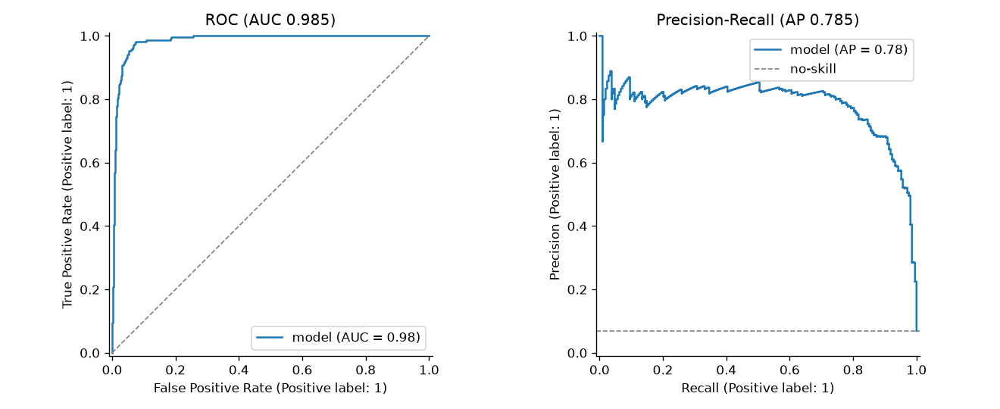
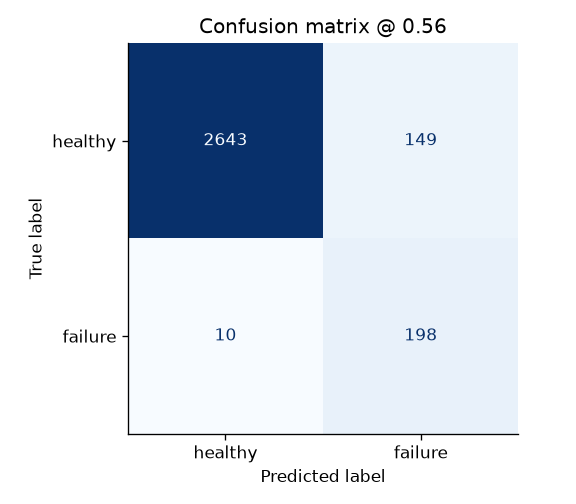
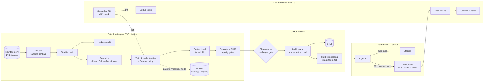

<div align="center">

# 🔋 EV Battery Failure Prediction — End-to-End MLOps

**Catch failing EV battery packs before they strand a driver: a production-style ML system, from raw telemetry to a monitored, self-retraining API on Kubernetes.**

[](https://github.com/akinpelumiajayi/ev-battery-failure-prediction/actions/workflows/ci.yml)
[](https://github.com/akinpelumiajayi/ev-battery-failure-prediction/actions/workflows/drift-check.yml)


[](LICENSE)

`DVC` · `MLflow` · `Optuna` · `SHAP` · `FastAPI` · `Docker` · `Kubernetes` · `Helm` · `ArgoCD` · `GitHub Actions` · `Prometheus` · `Grafana` · `Streamlit`

</div>

---

## The problem

A battery pack is the most expensive component of an electric vehicle. When one fails in service the
result is a roadside breakdown, a warranty pack replacement and sometimes a thermal-safety incident.
A fleet operator can't inspect every vehicle every week, so the real question is **which vehicles to
inspect now**.

This project answers that question from routine telemetry (BMS readings, charging behaviour, driving
patterns and environment). Because it is built as a *system* rather than a notebook, the model is also
versioned, tested, gated, deployed, observed and retrained automatically.

## Results

Held-out test set: 3,000 vehicles, 208 real failures (6.9 %). None of these vehicles were seen during
training, model selection or threshold tuning.

| | v1 (RandomForest, threshold 0.5) | **v2 (this version)** |
|---|---:|---:|
| ROC-AUC | 0.956 | **0.985** |
| PR-AUC (average precision) | 0.610 | **0.785** |
| Recall: failures caught | 62.0 % (129 / 208) | **95.2 % (198 / 208)** |
| Precision: flagged vehicles that really fail | 57.1 % | 57.1 % |
| Missed failures | 79 | **10** |

**Business view.** A missed failure is costed at 10× an unnecessary inspection, so the model flags
11.6 % of the fleet for inspection:

| Policy | Expected cost / vehicle | vs. doing nothing |
|---|---:|---:|
| Inspect nobody | 0.693 | — |
| Inspect everybody | 0.931 | +34 % |
| **Model, cost-optimal threshold** | **0.083** | **−88 %** |

<table>
<tr>
<td></td>
<td></td>
</tr>
<tr>
<td></td>
<td></td>
</tr>
</table>

> All figures and metrics are produced by `dvc repro` and regenerated by CI on every run. Numbers in
> this README come from [`models/test_metrics.json`](models/test_metrics.json).

## Architecture



## What this project demonstrates

| Capability | How | Where |
|---|---|---|
| **Reproducible pipeline** | 7-stage DVC DAG. Every parameter lives in `params.yaml`; `dvc repro` re-runs only what changed | [`dvc.yaml`](dvc.yaml), [`params.yaml`](params.yaml) |
| **Data contract** | pandera schema and business rules (ranges, uniqueness, class balance) fail the pipeline early | [`src/data/validate.py`](src/data/validate.py) |
| **Data versioning** | DVC pointer + md5-verified public mirror, so CI and fresh clones train on byte-identical data | [`src/data/fetch_data.py`](src/data/fetch_data.py) |
| **Leakage audit** | Single-feature AUC scan plus an ablation that removes every derived score | [`src/evaluation/leakage_audit.py`](src/evaluation/leakage_audit.py) |
| **Principled model selection** | 4 model families + Optuna, compared by 5-fold CV PR-AUC, all logged as nested MLflow runs | [`src/training/train.py`](src/training/train.py) |
| **Business-aware decisions** | Threshold chosen to minimise expected cost (FN = 10 × FP), not left at 0.5 | [`src/training/metrics.py`](src/training/metrics.py) |
| **Explainability** | SHAP global importance; per-prediction `/explain` endpoint returns the top risk factors | [`src/serving/app.py`](src/serving/app.py) |
| **Quality gates** | Absolute floors (ROC-AUC ≥ 0.90, PR-AUC ≥ 0.55), and a challenger may not regress PR-AUC by more than 0.02 vs. `main` | [`evaluate.py`](src/evaluation/evaluate.py), [`promotion_gate.py`](src/evaluation/promotion_gate.py) |
| **Model registry** | Each run registers a version; passing the gates moves the `@champion` alias | MLflow |
| **Serving** | FastAPI with typed contracts, batch endpoint, model card endpoint, Prometheus metrics | [`src/serving/`](src/serving) |
| **Containers** | Multi-stage, non-root image with the model baked in (immutable code + model per tag) | [`docker/`](docker) |
| **Kubernetes** | Helm chart: HPA, PDB, zero-downtime rolling updates, read-only root FS, ServiceMonitor | [`helm/`](helm/ev-battery-model) |
| **GitOps CD** | CI only edits Git; ArgoCD auto-syncs staging; prod goes via promotion PR + manual sync; optional Argo Rollouts canary | [`argocd/`](argocd), [`.github/workflows/`](.github/workflows) |
| **Monitoring** | Latency, throughput, risk-band mix, probability distribution, input missingness, errors; 5 alert rules | [`monitoring/`](monitoring) |
| **Closed loop** | PSI drift check (numeric + categorical) opens an issue and dispatches retraining | [`drift-check.yml`](.github/workflows/drift-check.yml) |
| **Engineering hygiene** | 49 hermetic tests, ruff, mypy, pre-commit, pinned lockfiles, `make help` | [`tests/`](tests), [`Makefile`](Makefile) |

## Quickstart

```bash
git clone https://github.com/akinpelumiajayi/ev-battery-failure-prediction.git
cd ev-battery-failure-prediction
python -m venv .venv && source .venv/bin/activate      # Python 3.12
make setup            # pinned dev dependencies + pre-commit hooks

make pipeline         # fetch data (md5-verified) → dvc repro  (~3 min on a laptop)
make test             # 49 tests, ~5 s
make serve            # API on http://localhost:8000/docs
make demo             # Streamlit UI on http://localhost:8501 (second terminal)
```

To run the whole stack in Docker (API, demo UI, MLflow, Prometheus and Grafana), run
`make docker-up`, then `docker compose --profile loadgen up loadgen` to send traffic.

| Service | URL |
|---|---|
| Demo UI | http://localhost:8501 |
| API (Swagger) | http://localhost:8000/docs |
| MLflow (experiments + registry) | http://localhost:5000 |
| Grafana (pre-provisioned dashboard) | http://localhost:3000 |
| Prometheus (alerts) | http://localhost:9090/alerts |

To run on Kubernetes locally, use `make kind-up kind-deploy`. This builds the image, loads it into kind and
installs the Helm chart with `--wait`, the same path the CI smoke test takes.

Run `make help` to list every target.

## The ML, in more detail

The design starts from data: the [EDA notebook](notebooks/01_eda.ipynb) maps each finding (class
imbalance, missingness, derived scores, signs of synthetic data) to the pipeline decision it drove.

### Model selection: the simplest model won

Every candidate is scored with **stratified 5-fold CV PR-AUC** on the training fold. PR-AUC is the
honest metric for a 7 % positive class, and CV is far less noisy than a single validation split with
about 200 positives. Optuna tunes LightGBM on the same folds, so all candidates compete on equal terms.

| Model | CV PR-AUC | Val PR-AUC | Val ROC-AUC |
|---|---:|---:|---:|
| **Logistic regression** (balanced) | **0.784** | 0.855 | 0.988 |
| LightGBM + Optuna (25 trials) | 0.779 | 0.847 | 0.986 |
| LightGBM | 0.768 | 0.844 | 0.986 |
| XGBoost | 0.767 | 0.847 | 0.986 |
| Random forest (v1 baseline) | 0.620 | 0.681 | 0.959 |

Regularised logistic regression edges out tuned gradient boosting. The signal in this dataset is close to
linear in the standardised features, so the extra capacity of boosting buys nothing. The linear model
also gives exact, cheap explanations and has a tiny serving footprint. The pipeline still runs every
family on each retrain, so if the data changes and boosting pulls ahead, it is promoted automatically.

### Decision threshold from a cost model, not 0.5

`params.yaml` sets the cost of a missed failure at 10 and an unnecessary inspection at 1. The threshold
minimising expected cost on the **validation** fold (0.555) is stored with the model and used by the API.
Risk bands are defined relative to it: *high* means "would be flagged" and *medium* starts at half the
threshold. If the business changes its cost ratio, it edits one number and the pipeline re-derives the
threshold.

### Is a 0.98 AUC too good to be true? The leakage audit

Eight columns are derived scores of unknown provenance (`thermal_runaway_risk`, `aging_score`,
`predicted_remaining_life_cycles`, …). If any were computed *from* the outcome, offline metrics would be
fiction. The `leakage_audit` stage checks this ([`reports/leakage_audit.json`](reports/leakage_audit.json)):

* **No single feature is suspiciously predictive.** The best one alone reaches AUC 0.85; the flag threshold is 0.95.
* **Ablation:** retraining with all eight derived scores removed leaves ROC-AUC almost unchanged
  (0.986 → 0.982, PR-AUC 0.837 → 0.799). The model's skill comes from raw sensor and usage signals, not
  from opaque pre-computed scores.

### Explainability

The global drivers of risk (above) are prior faults, BMS warnings, thermal risk, abnormal voltage
events, capacity loss and state of health, all physically plausible. Per prediction, `POST /explain`
returns exact SHAP contributions in log-odds, aggregated back from one-hot columns to the raw input
fields, so a technician sees *why* a vehicle was flagged.

## Serving API

| Method | Path | Purpose |
|---|---|---|
| `GET` | `/health` | Liveness/readiness (`degraded` if the model failed to load) |
| `GET` | `/model` | Model name, version (git SHA), threshold, risk bands, test metrics |
| `POST` | `/predict` | One vehicle → probability, decision, risk band |
| `POST` | `/predict/batch` | Up to 1,000 vehicles per call |
| `POST` | `/explain` | Prediction + top-k SHAP risk factors |
| `GET` | `/metrics` | Prometheus exposition |

```bash
curl -s -X POST localhost:8000/explain -H 'Content-Type: application/json' \
  -d '{"state_of_health": 64, "internal_resistance": 0.82, "BMS_warning_count": 5, "previous_faults": 3}'
```

Every field is optional, because real fleets have gaps. Missing values are filled by the *same fitted
imputer* used in training, out-of-range inputs are rejected with `422`, and unseen categories are handled.

## CI/CD and GitOps

| Workflow | Trigger | What it does |
|---|---|---|
| [`ci.yml`](.github/workflows/ci.yml) | PR, push to `main`, manual / drift dispatch | Runs lint, types, tests and Helm lint. Fetches the data, runs the full `dvc repro` with quality gates and the champion/challenger gate, and posts a model report on the PR. Verifies that the drift alarm fires. Builds the image, smoke-tests it in Docker and on a kind cluster via Helm, then pushes it to GHCR (main only). |
| [`cd.yml`](.github/workflows/cd.yml) | CI green on `main` | Rewrites `image.tag` in `values-staging.yaml` and commits; ArgoCD auto-syncs staging |
| [`promote-prod.yml`](.github/workflows/promote-prod.yml) | Manual | Verifies the image exists and opens a PR pinning prod to it; after review, prod is synced manually |
| [`drift-check.yml`](.github/workflows/drift-check.yml) | Weekly + manual (with scenarios) | Runs the PSI drift check. On drift it opens or updates a `data-drift` issue and dispatches CI to retrain |

**Why GitOps?** CI never holds cluster credentials. The cluster state is a pure function of Git, so
every production change has a reviewed commit, and a rollback is a `git revert`. Staging syncs
automatically for fast feedback. Production needs a reviewed PR *and* a manual sync.

## Monitoring and the drift loop

Ground truth (did the battery actually fail?) arrives weeks after a prediction, so the system watches
the earliest available proxies:

* **Service:** p50/p95/p99 latency, throughput, error rate (`APIDown`, `PredictionLatencyHigh`, `PredictionErrorRateHigh`)
* **Model output:** share of high-risk predictions and the full probability histogram (`HighRiskShareAnomalous`)
* **Input quality:** share of missing features per request (`InputMissingnessSpike`)
* **Data drift:** per-feature **PSI** against the training snapshot, numeric (decile bins with open-ended
  tails) and categorical (frequency, unseen categories included)

A batch counts as drifted when more than 10 % of features exceed PSI 0.2, **or** any single feature
exceeds PSI 1.0 (a broken upstream pipeline or a new market should never wait for a majority vote). Try it:

```bash
make drift-demo        # simulate a heatwave: hotter cells, more fast charging, degraded cooling
# DRIFT DETECTED: 10/67 features (15%) over PSI 0.20 — top: cell_temperature_max, ...
```

The same three scenarios (`heatwave`, `aging`, `new_market`) can be run from the **Actions → Drift check**
tab to watch the issue → retrain → gate → deploy loop end to end. CI also asserts on every run that a
simulated drifted batch trips the alarm, so the monitor itself is tested.

## Repository layout

```
├── src/
│   ├── common.py              # paths, params, logging
│   ├── data/                  # fetch_data (md5-verified) · validate (pandera) · preprocess (split)
│   ├── features/              # ColumnTransformer fit on train only → reused by the API
│   ├── training/              # model factory · metrics/threshold · train (CV + Optuna + MLflow)
│   ├── evaluation/            # evaluate (gates, SHAP, figures) · promotion_gate · leakage_audit
│   ├── monitoring/            # drift_check (PSI) · simulate_drift (scenarios)
│   └── serving/               # FastAPI app + pydantic schemas
├── notebooks/01_eda.ipynb     # EDA — each finding mapped to a pipeline design decision
├── tests/                     # 49 hermetic tests (synthetic fixtures, no pipeline needed)
├── demo/                      # Streamlit UI (talks to the API over HTTP)
├── docker/                    # serve · train · demo images
├── helm/ev-battery-model/     # chart + staging/prod values (what ArgoCD deploys)
├── argocd/                    # Applications (staging auto, prod manual) + canary Rollout
├── monitoring/                # Prometheus config + alerts, Grafana provisioning + dashboard
├── reports/                   # figures, leakage audit, feature importance (DVC outputs)
├── docs/                      # model card, dataset card
├── dvc.yaml · params.yaml     # pipeline DAG + every tunable
└── requirements/              # *.in (intent) → *.txt (pinned, uv-compiled)
```

## Engineering decisions and trade-offs

* **The serving image bakes the model in.** Each image tag is an immutable code + model pair, so
  rollbacks are trivial and pods have no runtime dependency on MLflow. The cost is one image build per
  model; at this model size (under 1 MB) that's the right trade.
* **One uvicorn worker per pod.** `prometheus_client` metrics are per-process; scaling is the HPA's job.
* **One feature transformer, persisted.** The API loads the fitted `ColumnTransformer`, so training and
  serving can't drift apart (no re-implemented feature logic).
* **Dependency-light drift detection.** PSI is about 40 lines of numpy and runs anywhere the training image
  runs; Evidently or whylogs would add reports, at the cost of a heavy dependency.
* **Local-first, cloud-portable.** The MLflow backend (SQLite) and data mirror are free to run. Moving to
  a team setup is configuration only: a hosted MLflow `tracking_uri` and an S3/GCS DVC remote.

## Limitations and next steps

* **The data looks synthetic** (for example, some model/body-type pairs are implausible, such as a
  "Mustang Mach-E" labelled *Truck*). The engineering transfers to real fleet data; the absolute metrics
  would not. See the [dataset card](docs/DATASET_CARD.md).
* **Probabilities are not calibrated.** `class_weight="balanced"` inflates them (Brier 0.043); decisions
  use the tuned threshold, so this affects the displayed probability, not the decision quality. Isotonic
  calibration is the next step if probabilities are consumed directly.
* **Single snapshot, no time dimension.** Real failure prediction would use sequences of telemetry and a
  temporal split (train on the past, test on the future). Survival analysis (time-to-failure) is a natural
  extension.
* **Inference logging:** the drift check runs on batches; logging live requests to object storage would
  let it monitor real traffic directly.

See the [model card](docs/MODEL_CARD.md) for intended use, evaluation details and ethical considerations.

## License

[MIT](LICENSE) © Akinpelumi Ajayi
